# 🏥 Modern Hospital Management System (DSA Edition)


## 📝 Short Description
This is a C++17 Hospital Management System for demonstrating OOP and Data Structures and Algorithms (DSA) in a college project. It stores selected records locally in CSV files for a normal application restart.

### 🔐 Demo credentials
- **Password:** `admin123`
*(Available only when no local `data/password.txt` has replaced it. This is a demo-only plain-text password, not production authentication.)*

---

## ✨ Modern UI Features
- **Clean Dashboard:** Simplified navigation inspired by Google’s minimalist design principles.
- **Color-Coded Feedback:** Uses ANSI colors for success (Green), errors (Red), and information (Blue).
- **Responsive Menus:** Logical task loops that prevent repetitive menu navigation.
- **Visual Hierarchy:** Consistent headers and card-like data displays.

---


## 🚀 Key Features
- **Doctor Directory:** Manage medical staff using a self-balancing tree.
- **Priority Appointments:** Schedule patients using a Binary Max-Heap.
- **Instant Patient Lookup:** Retrieve admitted patient data in constant time.
- **Hospital Navigator:** Find the shortest path between departments using Graph theory.
- **Smart Search Engine:** Prefix-based autocomplete for the predefined departments and doctor names.
- **Shift Rotator:** Manage Doctor on-call schedules using a Circular Linked List.
- **Record History:** Navigate completed check-ups during the current application session using a Doubly Linked List.
- **Emergency Management:** Persistent stack-based tracking for urgent cases.
- **Local Persistence:** Appointments, admitted patients, staff records, feedback, and emergency records are saved to CSV files when the application closes and loaded on the next launch.
- **System Logger:** Thread-safe logging of all major system events.

---

## 🧠 DSA Concepts Used

| Concept | Implementation | Time Complexity | Why we used it? |
| :--- | :--- | :--- | :--- |
| **Circular Linked List** | `ShiftRotator` | $O(1)$ | To cycle through the Doctors on-call indefinitely (circular shift rotation). |
| **Doubly Linked List** | `PatientHistory` | $O(1)$ | To allow navigation "Backward" and "Forward" through recently viewed records. |
| **AVL Tree** | `HospitalDirectory` | $O(\log N)$ | To keep the doctor database balanced, preventing $O(N)$ degradation. |
| **Binary Max-Heap** | `PriorityQueue` | $O(\log N)$ | To ensure the most critical patients are served first in the appointment list. |
| **Hash Map** | `admittedPatientsMap` | $O(1)$ | To provide near-instant retrieval of admitted patients by their ID. |
| **Graph (Adj List)** | `HospitalGraph` | $O(V + E)$ | To model the physical layout of the hospital as a network of nodes and edges. |
| **Dijkstra’s Algorithm** | `findShortestPath` | $O(E \log V)$ | To calculate the most efficient route from the Entrance to any department. |
| **Trie (Prefix Tree)** | `SearchEngine` | $O(L)$ | To provide autocomplete suggestions for staff and department searches. |
| **Stack** | `EmergencyStack` | $O(1)$ | To maintain a "Last-In, First-Out" history of emergency patient discharges. |
| **Queue** | `complaintsQueue` | $O(1)$ | To address patient complaints in the order they were received (FIFO). |

---

## 🗺️ Diagrams

### 1. Program Flow

```mermaid
flowchart TD
    %% ---------------------------------------------------------
    %% 1. INITIALIZATION & BOOTSTRAP
    %% ---------------------------------------------------------
    subgraph STARTUP [Step 1: System Initialization]
        Main[main.cpp] --> AppInit[HospitalApp Constructor]
        AppInit --> LoadPass[Utility::loadPassword]
        AppInit --> LoadRecords[HospitalDirectory::loadRecords - AVL Tree]
        AppInit --> PopSearch[HospitalApp::populateSearchEngine - Trie]
        AppInit --> ShiftInit[ShiftRotator::addDoctor - Circular Linked List]
    end

    %% ---------------------------------------------------------
    %% 2. SECURITY GATEWAY
    %% ---------------------------------------------------------
    subgraph AUTH [Step 2: Secure Gateway]
        LoadPass --> Login{HandleLogin Loop}
        Login -- Invalid Key --> ShowError[UI::showStatus - Error]
        ShowError --> Login
        Login -- Valid Key --> Loading[Utility::showLoading]
        Loading --> Dashboard[Central Dashboard]
    end

    %% ---------------------------------------------------------
    %% 3. CENTRAL DASHBOARD ROUTING
    %% ---------------------------------------------------------
    subgraph DASH [Step 3: Central Dashboard Routing]
        Dashboard --> MenuChoice{UI::showMenu}
        
        MenuChoice -- [1] --> StaffPortal[Medical Staff Directory]
        MenuChoice -- [2] --> NursePortal[Nursing & Wards]
        MenuChoice -- [3] --> PatientPortal[Patient Care Portal]
        MenuChoice -- [4] --> ERPortal[Emergency Unit]
        MenuChoice -- [5] --> AdminPortal[Administrator Hub]
        MenuChoice -- [6] --> NavPortal[Hospital Navigation]
        MenuChoice -- [7] --> UnifiedSearch[Unified Search Engine]
        MenuChoice -- [8] --> ViewHist[Viewing History]
        MenuChoice -- [9] --> SecSettings[Security Settings]
        MenuChoice -- [0] --> Shutdown[Exit System]
    end

    %% ---------------------------------------------------------
    %% 4. MODULE-SPECIFIC LOGIC & DATA STRUCTURES
    %% ---------------------------------------------------------
    
    %% Staff Directory (AVL Tree)
    subgraph STAFF_AVL [Directory - AVL Tree]
        StaffPortal --> AVL_Ops[Insert / Delete / Search / Display]
        AVL_Ops -.-> CSV_Staff[(data/hospital_records.csv)]
    end

    %% Nurse & Wards (Hash Map)
    subgraph NURSE_MAP [Wards - Unordered Map]
        NursePortal --> Map_Ops[Admit Patient / Modify Data / Display Admitted]
        Map_Ops -.-> CSV_Admitted[(data/admitted.csv)]
    end

    %% Patient Portal (Max-Heap)
    subgraph PATIENT_HEAP [Care Portal - Max Heap]
        PatientPortal --> Heap_Ops[Book Appointment / Cancel / Check-up]
        PatientPortal --> Feedback[Register Complaint - Queue]
        Heap_Ops -.-> CSV_Appts[(data/appointments.csv)]
        Feedback -.-> CSV_Complaints[(data/complaints.csv)]
    end

    %% ER Unit (Two Stacks)
    subgraph ER_STACK [Emergency Unit - Stack]
        ERPortal --> ER_Ops[Register Case / Triage / Discharge]
        ER_Ops -.-> CSV_ER[(data/emergency_current.csv / emergency_old.csv)]
    end

    %% Admin Hub (Circular Linked List)
    subgraph ADMIN_CLL [Admin Hub - Circular LL]
        AdminPortal --> Shift_Ops[Rotate Shifts / ShiftRotator::nextShift]
        AdminPortal --> StaffMgmt[Add/Remove Professionals]
    end

    %% Navigation (Graph)
    subgraph NAV_GRAPH [Navigation - Graph]
        NavPortal --> Dijkstra[HospitalGraph::findShortestPath]
        Dijkstra --> PathOutput[Show Optimal Route]
    end

    %% Unified Search (Trie)
    subgraph SEARCH_TRIE [Search - Prefix Trie]
        UnifiedSearch --> TrieSearch[Trie::searchPrefix]
        TrieSearch --> AutoComp[Show Match Results]
    end

    %% History (Doubly Linked List)
    subgraph HIST_LIST [History - Doubly Linked List]
        ViewHist --> Undo[PatientHistory::undoView]
        ViewHist --> Redo[PatientHistory::redoView]
    end

    %% ---------------------------------------------------------
    %% 5. CROSS-CUTTING UTILITIES
    %% ---------------------------------------------------------
    subgraph UTILS [Cross-Cutting Helpers]
        UI_H[UIComponents.h] -.-> |Colors/Logo/Borders| Dashboard
        Utility_H[Utility.h] -.-> |SafeInt/ClearScreen/Sleep/Sanitize| AVL_Ops
        Logger_H[Logger.h] -.-> |Error & Event Logging| Map_Ops
        Billing_H[BillingService.h] -.-> |Invoice Generation| ER_Ops
    end

    %% ---------------------------------------------------------
    %% 6. SYSTEM SHUTDOWN
    %% ---------------------------------------------------------
    Shutdown --> Sync[Syncing Local Data...]
    Sync --> SaveAVL[Save Staff CSV]
    Sync --> SaveHeap[Save Appts CSV]
    Sync --> End((PROGRAM END))

    %% Connections back to Dashboard
    AVL_Ops --> Dashboard
    Map_Ops --> Dashboard
    Heap_Ops --> Dashboard
    ER_Ops --> Dashboard
    Shift_Ops --> Dashboard
    PathOutput --> Dashboard
    AutoComp --> Dashboard
    Undo --> Dashboard
```


---

## 💾 Data Persistence & File Handling
Selected system data persists across normal application restarts using CSV (Comma-Separated Values) files and thread-safe logging.

### 📁 Database Structure
The application maintains several flat-file databases in the `data/` directory:
- **`hospital_records.csv`**: Stores medical staff data (ID, Name, Speciality, Surgeon Status).
- **`admitted.csv`**: Tracks currently admitted patients and their assigned wards.
- **`appointments.csv`**: Manages the priority-based appointment queue.
- **`complaints.csv`**: Stores patient feedback for administrative review.
- **`emergency_current.csv`** and **`emergency_old.csv`**: Store active and discharged emergency cases.
- **`password.txt`**: Stores the demo administrator password in plain text.

### ⚙️ File Handling Logic
- **Startup Loading:** On launch, staff, appointments, admissions, complaints, and emergency records load into their respective in-memory structures when their local files exist.
- **Session Sync:** Each managed data structure writes its current state when the application closes normally.
- **CSV Parsing:** Uses `std::stringstream` and `std::getline` with custom delimiters to safely parse and tokenize record fields, handling edge cases like empty lines or corrupted data.
- **Robustness:** Includes `Utility::safeStoi` and sanitization checks to ensure that manual edits to the CSV files do not crash the application.
- **Thread-Safe Logging:** Implements a Singleton `Logger` class that uses a `std::mutex` to safely record all system events to a log file, even in multi-threaded environments.

---

## 📂 Project Structure
```text
Hospital-Management-System-cpp/
├───data\               # Persistent CSV storage and password files
├───include\            # Header files (.h) - Class and Method declarations
│   ├───BillingService.h
│   ├───EmergencyManagement.h
│   ├───HospitalApp.h
│   ├───HospitalDirectory.h
│   ├───HospitalGraph.h
│   ├───Logger.h
│   ├───Patient.h
│   ├───PatientHistory.h
│   ├───PriorityQueue.h
│   ├───ShiftRotator.h
│   ├───Trie.h
│   ├───UIComponents.h
│   └───Utility.h
├───src\                # Source files (.cpp) - Business Logic implementation
│   ├───BillingService.cpp
│   ├───EmergencyManagement.cpp
│   ├───HospitalApp.cpp
│   ├───HospitalDirectory.cpp
│   ├───HospitalGraph.cpp
│   ├───Logger.cpp
│   ├───main.cpp
│   ├───PriorityQueue.cpp
│   └───Trie.cpp
├───CMakeLists.txt      # Build configuration
└───README.md           # Main documentation
```

---

## 🛠️ How to Build and Run

### Option 1: Using Visual Studio (Recommended for Windows)
1. **Download:** Download the project as a `.zip` file and extract it.
2. **Open:** Open Visual Studio and select **"Open a local folder"**. Choose the extracted `DSA-Hospital-System` folder.
3. **Wait for CMake:** Visual Studio will automatically detect the `CMakeLists.txt` and start "Generating CMake cache." Wait for the output window to finish.
4. **Select Startup Item:**
   - At the top bar, look for the green "Play" button.
   - Click the dropdown next to it (it might say "Select Startup Item").
   - Choose **`HospitalApp.exe (Install)`** or **`HospitalApp.exe`**.
5. **Run:** Press **F5** or the **Play Button** to start.

### Option 2: Using CMake Command Line
```bash
# 1. Generate the build files
cmake -S . -B build

# 2. Build
cmake --build build

# 3. Run (macOS/Linux)
./build/HospitalApp

# On Windows, use: .\build\HospitalApp.exe
```

### Quick demonstration path (macOS)

1. Run `./build/HospitalApp`, then choose `1` at the secure gateway and enter the demo password above if no local password file exists.
2. From the dashboard: `5` opens staff administration, `3` opens appointments and feedback, `2` opens admitted-patient notes, and `4` opens emergency cases.
3. Use `6` for the shortest-route demonstration, `7` for prefix search, `8` for the current-session viewing history, and `9` to change the demo password.
4. Use fictional data only. Exit through `0` so the application performs its normal local-data save.

### 🔧 Troubleshooting the "Play Button" in VS (Rare)
If you don't see the Play button:
1. Go to **Project -> Generate Cache for HospitalManagementSystem**.
2. Right-click `CMakeLists.txt` in the Solution Explorer and select **"Set as Startup Item"**.
3. Make sure the full folder path of this project contains no special characters (e.g. &, %, #, !).
   If it does, rename the folder — otherwise the project will compile successfully but fail at the linking stage and refuse to run.

---

## 👨‍💻 Author
This repository originated from shashwat,pratham,akansha 3rd sem oops projects.

## 📄 License and distribution

No `LICENSE` file is present in this checkout. Before publishing, redistributing, or claiming rights beyond coursework submission, confirm the upstream repository's licensing and permission terms. This project has not been pushed or published from this workspace.

## 📚 Submission materials

The submission package includes:


- [Test checklist, presentation notes, and viva preparation](SUBMISSION_MATERIALS.md)

Local CSV, log, and password files under `data/` are intentionally ignored by Git. Use fictional data only and do not commit credentials or real patient information.
